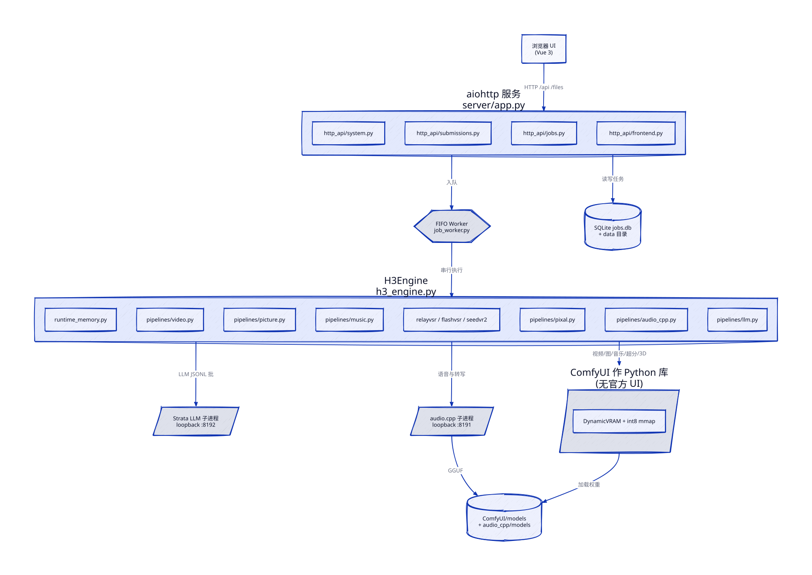
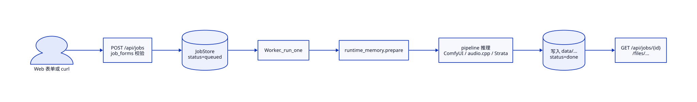

# 核心概念与架构

下面按**真实模块名**说明。图用 D2 从源文件渲染，节点对应仓库路径。

## 整体结构

手绘风版本：

### 分层

1. **浏览器**（`web/`）：Vue 3。导航注册在 `web/src/generationModes.js`（视频 / 图片 / 音频 / 3D）。`GenerateForm.vue` 只做族级路由与 KeepAlive；具体表单在 `forms/*Form.vue`。
2. **HTTP**（`server/app.py`）：组装 aiohttp Application。路由拆在 `http_api/`：`system`（health/presets/unload）、`submissions`（创建任务）、`jobs`（列表/详情/取消/超分/删除）、`frontend`（SPA）。
3. **持久化**（`h3_jobs.py`）：SQLite `jobs.db`，线程锁；`result` / `refs` 等 JSON 列。
4. **Worker**（`job_worker.py`）：守护线程，FIFO，**严格一次一个任务**（连续语音任务可在 audio.cpp 实例池上并行）。
5. **引擎**（`h3_engine.py`）：ComfyUI bootstrap、模型缓存、取消、显存策略；具体生成在 `pipelines/`。
6. **外部运行时**：
   - ComfyUI 作为库（`comfy_launcher/run_h3.py` 里的 `bootstrap_comfy`）
   - `audio.cpp` 子进程（仅 loopback，默认端口 8191）
   - 可选 Strata LLM（默认 8192）

静态成品走 `/files/{videos,pictures,music,thumbs,uploads,speech,transcripts,models3d,llm}`。

## 一次任务怎么走

要点：

- `POST /api/jobs` → `job_forms/*` 校验 multipart → `JobStore` 记 `queued` → Worker 出队
- 跑之前 `runtime_memory` 按任务族决定：保留 Comfy 权重、卸载给 audio.cpp/Pixal3D/FlashVSR、或停 Strata
- 推理结束后写文件并更新 `done` / `failed` / `canceled`
- 客户端轮询 `GET /api/jobs/{id}`；文件 URL 相对站点根

## 后端代码边界（README / CLAUDE.md）

| 模块 | 职责 |
|---|---|
| `server_settings.py` | 读环境变量与路径；每应用一份 settings |
| `model_catalog.py` | 视频/共享注册表（纯标准库） |
| `image_models.py` | 图片模型选择、能力、校验和下载 |
| `audio_catalog.py` | 语音/ASR GGUF 与 checksum |
| `job_forms/` | 各族 multipart 字段构建 |
| `job_uploads.py` | 上传校验与落盘 |
| `job_views.py` | 任务 JSON 序列化 |
| `pipelines/*` | 视频、图、音乐、超分、3D、语音、LLM |

GPU 相关 import 延迟到管线真正跑、且 ComfyUI 已 bootstrap 之后。

## 前端结构

- 历史面板跟当前任务族走：`GET /api/jobs?kind=video|image|music|3d`（省略 `kind` 则全部）
- 草稿按族分开存；从旧版合并草稿迁移
- 卡片操作条横向滚动；超分菜单在条外，避免裁切

## 模型与「LoRA」选择

前端/API 里的 `lora` 字段名历史遗留：它也用来选 **FastH3 蒸馏底模**（无 LoRA 文件）和 **Pika H3 Flex**。

三组（细节以 `/api/presets` 为准）：

1. **MiniMax-H3 + LoRA**：fl2va 底 + larryvrh turbo（推荐 sparse）
2. **FastVideo FastH3**：8-step 蒸馏底，无 LoRA；参考模式用 OmniRef
3. **Pika H3 Flex**：官方 fl2va/ref2va + Pika BF16 LoRA，固定 6-step sigma 日程

底模随模式切换：文本/图生视频用 fl2va 族；参考模式用 ref2va / OmniRef 族。切换底模大约秒级（DynamicVRAM + mmap）。

## 显存策略（摘要）

- 健康连续任务复用模型对象与热权重；**没有空闲定时卸载**
- 任务前检查可用显存（含可复用 allocator 缓存）是否满足最低 headroom
- 换图片模型或视频底模时，只释放旧族
- 进入 audio.cpp / Pixal3D / FlashVSR 会卸掉 ComfyUI GPU 权重（CPU 侧对象可仍缓存）
- OOM：当前任务失败并尝试回收；失败则 Worker 进入 error，需重启服务；队列仍在库里
- 空闲时可 `POST /api/unload` 主动腾 GPU（有任务时 409）

## 配置如何进进程

`deploy.sh` 用 `server/h3-server.service.in` 模板，把 `@COMFYUI@`、`@DATA@`、`@COMFY_ARGS@`、audio/Strata 占位符换成 `.env` 值，再 `systemctl enable/restart`。

下一篇：[常见用法与进阶](05-usage.md)。上一篇：[最小可跑通](03-quickstart.md)。
